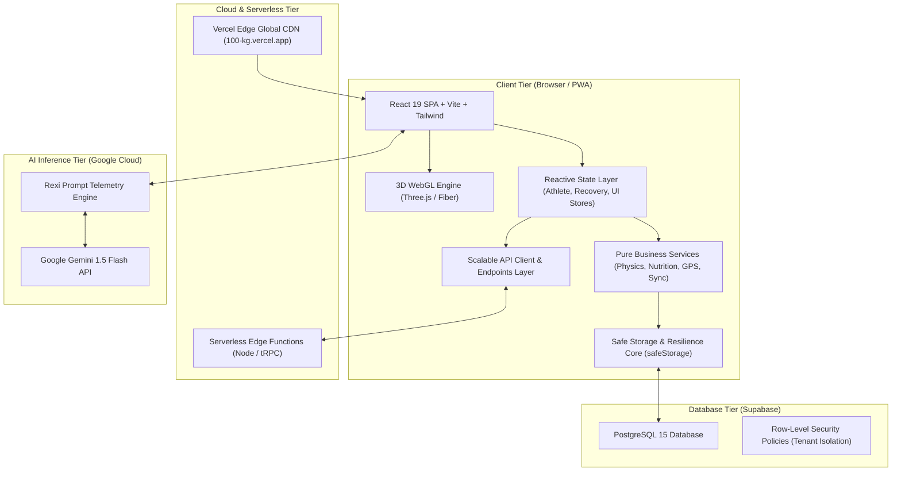
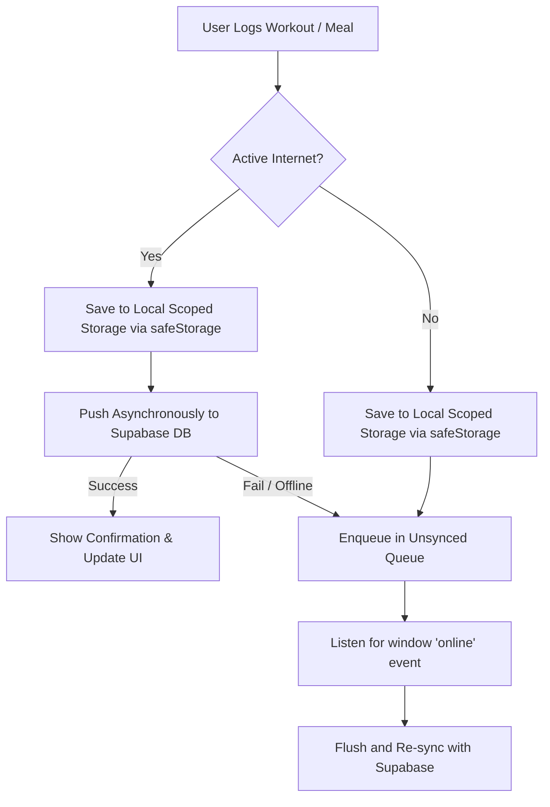

# 🏛️ System Architecture Document
## 100KG — Performance Operating System
**Smart India Hackathon 2026 (SIH 2026)**

---

## 1. High-Level Architecture Overview

100KG is designed as a **modern, cloud-native, offline-resilient Single Page Application (SPA)** that combines client-side high-speed computing with cloud serverless elasticity and generative AI inference.



---

## 2. Modular Codebase Organization & Clean Architecture

The codebase follows strict **Clean Architecture** principles, enforcing separation of concerns between view rendering, business domain rules, application state, and external input/output infrastructure.

```
client/src/
├── config/                 # Environment validation and app-wide constants
│   ├── env.ts              # Typed, fail-safe environment variable parsing
│   └── constants.ts        # Storage keys, app events, and telemetry thresholds
├── core/                   # Low-level infrastructure primitives & resilience
│   ├── errors/             # Custom error hierarchy & Global ErrorBoundary
│   │   ├── app-error.ts    # AppError, AuthError, NetworkError, ValidationError
│   │   └── error-boundary.tsx # High-resilience telemetry crash recovery boundary
│   └── storage/            # Multi-tenant, scoped, safe storage abstraction
│       └── safe-storage.ts # Safe JSON parser, auto-deduplicating multi-key resolver
├── types/                  # Single source of truth for domain data contracts
│   ├── athlete.ts          # Athlete profile, streak, calibration, hydration
│   ├── workout.ts          # Workout session, exercise set, telemetry logs
│   ├── recovery.ts         # Muscle ID, recovery status, fatigue scoring
│   ├── nutrition.ts        # Macro totals, meal slots, food dictionary
│   ├── gps.ts              # GPS coordinates, live telemetry route session
│   ├── api.ts              # Generic API response and pagination wrappers
│   └── index.ts            # Centralized barrel export
├── services/               # Pure, headless business logic (no React dependencies)
│   ├── fitness/            # Mifflin-St Jeor BMR, TDEE, asymptotic recovery decay
│   │   └── calculator.service.ts
│   ├── nutrition/          # Macro sums, target differentials, fuzzy food search
│   │   └── nutrition.service.ts
│   ├── gps/                # Haversine distance, speed-gating, MET expenditure
│   │   └── telemetry.service.ts
│   ├── sync/               # Local DB JSON backup and CSV workout export
│   │   └── database-backup.service.ts
│   └── api/                # Scalable HTTP communication layer
│       ├── client.ts       # Unified fetch client with timeout and error mapping
│       ├── endpoints/      # Typed endpoint controllers (athlete, workout, nutrition, gps)
│       └── index.ts        # Centralized barrel export
├── state/                  # Reactive UI & Domain State Stores
│   ├── athlete.store.ts    # Athlete profile, biometrics, onboarding lifecycle
│   ├── recovery.store.ts   # Real-time muscle fatigue, overall readiness
│   ├── ui.store.ts         # Sidebar collapsed state, active dialogs, toast queue
│   └── index.ts            # Centralized barrel export
├── utils/                  # Deterministic utility helpers
│   ├── date.ts             # ISO date keying, streak calculation, greeting periods
│   └── number.ts           # Number formatting, metric unit clamps
├── components/             # Presentational UI components & Design Primitives
│   ├── 3d/                 # Three.js anatomical body scenes and shaders
│   ├── dashboard/          # Metric cards, orbital rings, streak banners
│   ├── gps/                # GPS route tracking & live telemetry maps
│   ├── layout/             # Sidebar, Header, Workflow navigation
│   └── ui/                 # Accessible Radix primitives
└── pages/                  # Thin route controllers (wire stores to UI views)
    ├── Home.tsx            # Overview telemetry and recovery ring
    ├── BodyMap.tsx         # 3D interactive muscle recovery canvas
    ├── LogWorkout.tsx      # Workout logger with muscle targeting
    ├── LogFood.tsx         # Nutritional tracking & meal logger
    ├── GpsTracker.tsx      # Real-time GPS path recording
    └── Settings.tsx        # Profile calibration, cloud sync & local backups
```

---

## 3. Mathematical & Physiological Service Models

All physiological calculations are extracted into pure services in `client/src/services/` with zero side effects:

### 3.1 Basal Metabolic Rate (BMR) & Daily Expenditure (TDEE)
Implemented in [`calculator.service.ts`](file:///c:/Users/Lenovo/Downloads/fit-repo/client/src/services/fitness/calculator.service.ts):
- **Clinical Mifflin-St Jeor Equation**:
  $$BMR_{\text{male}} = 10 \cdot W + 6.25 \cdot H - 5 \cdot A + 5$$
  $$BMR_{\text{female}} = 10 \cdot W + 6.25 \cdot H - 5 \cdot A - 161$$
  *(where $W$ is weight in kg, $H$ is height in cm, $A$ is age in years)*
- **Total Daily Energy Expenditure**:
  $$TDEE = BMR \times \text{Multiplier}(\text{activityLevel})$$
  *(Multipliers: Light = 1.375, Moderate = 1.55, Active = 1.725, Very Active = 1.9)*

### 3.2 Asymptotic Muscle Recovery Decay Model
The dynamic muscle recovery percentage $S(t) \in [0, 100]$ after an acute training stress event is modeled via an asymptotic exponential decay function:
$$S(t) = S_0 + (100 - S_0) \cdot \left(1 - e^{-t / \tau}\right)$$
- $S_0$: Immediate post-workout baseline recovery score (derived from total training volume).
- $t$: Elapsed time in hours since the workout was logged.
- $\tau$: Muscle recovery time constant ($\approx 18.0$ hours), yielding $\sim 95\%$ full readiness at 48 hours for standard major muscle groups.

### 3.3 Great-Circle GPS Geodesic Distance
Implemented in [`telemetry.service.ts`](file:///c:/Users/Lenovo/Downloads/fit-repo/client/src/services/gps/telemetry.service.ts):
- Haversine formula calculation with multipath velocity jitter gating:
  $$d = 2 R \cdot \arcsin\left(\sqrt{\sin^2\left(\frac{\Delta \phi}{2}\right) + \cos(\phi_1)\cos(\phi_2)\sin^2\left(\frac{\Delta \lambda}{2}\right)}\right)$$
- Coordinates exhibiting physically impossible human walking/running speeds ($> 45 \text{ km/h}$) or GPS noise radii ($< 2 \text{ meters}$) are rejected automatically by telemetry filters.

---

## 4. Architectural Layers

### 4.1 Presentation & UI Layer
* **Framework**: React 19.2.1 running on Vite 7.1.9 for ultra-fast Hot Module Replacement (HMR) and sub-second asset bundling.
* **Component Architecture**: Atomic component design combining headless accessible primitives (**Radix UI**) with high-performance CSS utilities (**Tailwind CSS v4**).
* **Kinetic Animations**: **Framer Motion 12** provides hardware-accelerated spring animations for dialogs, cards, metric rings, and screen transitions.
* **Routing**: Lightweight client-side hash/path router via **Wouter 3.7** maintaining a microscopic bundle size ($<12\text{ kB}$).

### 4.2 3D Graphics & Telemetry Layer
* **Rendering Engine**: **Three.js 0.185** with `@react-three/fiber` (React reconciler) and `@react-three/drei` (helpers).
* **3D Anatomy Canvas**: Renders high-fidelity anatomical meshes depicting 10 distinct muscle clusters with custom vertex/fragment shaders and emissive materials that update dynamically based on fatigue scores.
* **Orbital Readiness Form**: Interactive mathematical torus knot geometries rotating dynamically on the Home dashboard to visually encode daily athletic recovery readiness (0–100).

### 4.3 State Management & Data Layer
* **Reactive Zustand-like State Layer**:
  - Independent, decoupled reactive stores (`AthleteStore`, `RecoveryStore`, `UiStore`) maintaining deterministic subscriptions and custom event dispatching (`100KG:recovery-update`).
* **Dual-Tier Storage Architecture**:
  1. **Immediate Local Cache**: All user transactions (workouts, weigh-ins, meals, preferences) are committed synchronously to browser `localStorage` using `safeStorage`. Supports both modern `100KG_*` and backward-compatible `fittrack_*` scoped keys.
  2. **Asynchronous Cloud Sync**: Background synchronization workers (`supabase-sync.ts`) push and pull delta records to Supabase PostgreSQL without blocking the main render thread.

### 4.4 AI Intelligence Layer (Rexi Engine)
* **Model**: Google Gemini 1.5 Flash API via HTTPS REST and SDK streaming.
* **Dynamic Context Augmentation (RAG-Lite)**:
  * The client intercepts the athlete's prompt and injects live physiological metrics (BMR, TDEE, consumed calories, target deficit, experience tier, recent workouts, device time) before forwarding to Gemini.

---

## 5. Security Architecture & Multi-Tenancy

### 5.1 Tenant Isolation via PostgreSQL Row-Level Security (RLS)
Every row in the cloud database is keyed to the athlete's unique identifier (`user_email`). PostgreSQL database policies guarantee that cross-tenant read/write queries are strictly rejected at the SQL engine level.

```sql
-- Database-Enforced Session Context
CREATE OR REPLACE FUNCTION public.current_athlete_email()
RETURNS VARCHAR AS $$
BEGIN
    RETURN NULLIF(current_setting('request.jwt.claims', true)::json->>'email', '');
EXCEPTION
    WHEN OTHERS THEN
        RETURN NULL;
END;
$$ LANGUAGE plpgsql STABLE SECURITY DEFINER;

-- Multi-Tenant Isolation Policy
CREATE POLICY "athlete_isolation_policy" 
ON public.workout_logs
FOR ALL 
USING (user_email = public.current_athlete_email() OR user_email = current_user);
```

### 5.2 Cryptographic Client-Side Security
* **Credential Protection**: Passwords entered through email authentication are hashed client-side using the native **Web Crypto API** (`crypto.subtle.digest("SHA-256")`) before transmission or local verification.
* **Google Identity Services (GIS) Token Validation**: Google OAuth JWT tokens are cryptographically parsed and checked against `client_id` audience claims (`aud`) and expiration timestamps (`exp`) to prevent token substitution attacks.

---

## 6. Offline-First & Network Resilience Architecture



* **Zero Data Loss**: In basements or intermittent gym deadzones, workouts and food logs are written instantly to local storage.
* **Auto-Reconciliation**: The moment connectivity returns, `supabase-sync.ts` detects the connection, authenticates, and commits all queued sessions in chronological order.
* **Data Portability**: Full JSON database backup and CSV workout history export are built into the Settings command deck.

---

## 7. Deployment & Infrastructure Pipeline

* **Production Hosting**: Vercel Serverless Edge Global CDN.
  - Primary Domain: `https://100-kg.vercel.app`
  - High-Availability Aliases: `https://100kg-app.vercel.app`, `https://the100kg.vercel.app`, `https://fit-repo.vercel.app`
* **Source Control**: Git GitHub Repository (`https://github.com/ANIKETCHAND/100KG.git` branch `main`).
* **Continuous Integration & Delivery (CI/CD)**:
  - TypeScript strict verification (`pnpm exec tsc --noEmit`)
  - Automated contract and unit testing with Vitest (`pnpm test`)
  - Fast asset compilation (`vite build`) and instant global atomic edge deployment.
